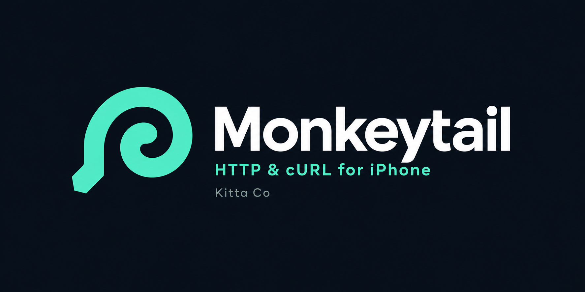
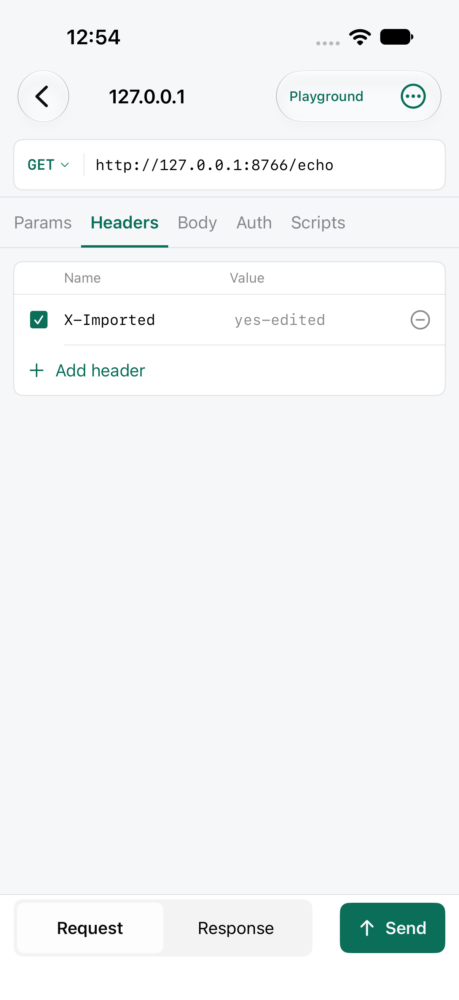
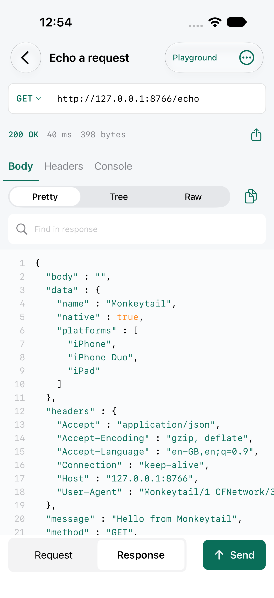

<p align="center"></p>

[English](README.md) · [Español](README.es.md) · [Français](README.fr.md) · [日本語](README.ja.md) · [한국어](README.ko.md) · **简体中文**

# Monkeytail

**适用于 iPhone、iPad、Mac 和 Apple Vision Pro 的原生 API 客户端。直接带上你的 Postman 和 Insomnia 集合，脚本照常运行，无需登录。**

Monkeytail 打开你现有的集合，并以相同的方式运行。没有 Monkeytail 账户，没有登录墙，没有云端工作区，也没有遥测。请求直接发送到你的服务器，数据保留在你的设备或你自己的 iCloud 云盘中。

<p> </p>

## 下载

**[在 App Store 下载](https://apps.apple.com/app/id6814706725)**：适用于 iPhone、iPad、Mac 和 Apple Vision Pro，免费且无 App 内购买。网站：[monk.ieb.app](https://monk.ieb.app)

## 从 Postman 或 Insomnia 迁移

- **全部导入。** 支持 Postman 集合（v1、v2、v2.1）、环境、全局变量和完整数据导出，Insomnia v4 与 v5 导出，以及 Bruno、Hoppscotch、Thunder Client、HAR、`.http` 文件、OpenAPI/Swagger 和 cURL。可一次选择多个文件或整个文件夹。
- **也可以直接从云端拉取。** 登录一次 Postman、Insomnia 或 Hoppscotch 即可拉取已同步的工作区，或指定一个 GitHub 仓库。会话仅用于本次导入，绝不保存。
- **脚本照常运行。** 请求前脚本和测试脚本通过兼容 Postman 的 `pm` API 运行，包括 `pm.test`、`pm.expect`、`pm.sendRequest`、CryptoJS、lodash 和 moment。Insomnia、Bruno 等客户端的脚本通过兼容对象运行。
- **熟悉的使用方式。** 工作区、集合和嵌套文件夹可继承认证、标头、变量和脚本；支持环境、全局变量和 `{{变量}}`，包括 `{{$guid}}` 等动态变量。
- **随时导出。** 导出为 Postman v2.1、Insomnia v4，或无损的 Monkeytail JSON 文件。

## 其他功能

- HTTP、支持内省的 GraphQL、WebSocket 和服务器发送事件
- OAuth 2.0（PKCE）、OAuth 1.0、JWT、AWS Signature V4、Digest、API 密钥、Basic 和 Bearer
- 集合运行器，支持多次迭代和 CSV/JSON 数据文件，可导出 JSON 或 JUnit 报告
- 可视化断言、已存储的示例、离线模拟和本地模拟服务器
- 响应查看器：格式化 JSON、树状视图、搜索、比较、图像、音频、视频和十六进制
- 13 种语言的代码生成，以及 cURL 导入与导出
- 耗时明细、TLS 详细信息、HTTP/HTTPS/SOCKS5 代理、客户端证书和可选的浏览器 TLS 配置文件
- 主题、自定义颜色和字体，支持英语、西班牙语、法语、日语、韩语和简体中文
- 通过你自己的 iCloud 云盘同步，并提供可发送个人收藏请求的 Apple Watch 配套应用

了解更多：[API 工具](docs/APITools.md) · [脚本](docs/Scripting.md) · [浏览器配置文件](docs/BrowserProfiles.md) · [示例工作区](docs/examples)

## 构建

在 Xcode 中打开 `Monkeytail.xcodeproj`，运行 **Monkeytail**（iPhone 和 iPad）、**MonkeytailMac** 或 **MonkeytailVision** 方案。需要 iOS 17、macOS 14 或 visionOS 1 及更高版本。编辑 `project.yml` 后，请运行 `xcodegen generate`。

## 测试

```sh
swift test
```

## 许可证

[BSD 3-Clause](LICENSE)
