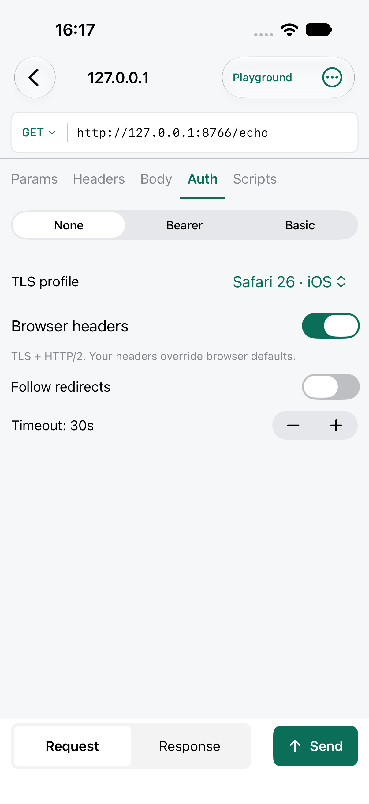

# Browser TLS profiles

Open a request’s **Auth** tab and choose **TLS profile**. **System** uses the normal Apple networking stack. A browser profile uses the bundled curl-impersonate stack to reproduce that preset’s TLS ClientHello and HTTP/2 settings directly on the device.



| Profile | cURL identifier |
| --- | --- |
| Chrome 150 | `chrome150` |
| Chrome 131 · Android | `chrome131_android` |
| Firefox 147 | `firefox147` |
| Safari 26.0.1 · Mac | `safari2601` |
| Safari 26 · iOS | `safari260_ios` |

Enable **Browser headers** to include the preset’s User-Agent and other browser headers. Headers you enter explicitly take precedence. Turn it off to keep only the TLS/HTTP2 profile when replaying headers copied from a browser. Importing an ordinary browser “Copy as cURL” command does not choose a profile automatically; choose the matching preset after import.

Profiles match the pinned versions above, not every browser version. This changes the network handshake and optional default headers; it does not run a browser page, JavaScript, or a browser cookie store. Sites can also inspect request contents and application behavior.

## Import and export

Browser requests export as commands for **curl-impersonate 2.2.3 or later**:

```sh
curl-impersonate --request GET --impersonate 'chrome150' 'https://example.com'
```

With Browser headers disabled, the upstream `:no` suffix preserves the choice:

```sh
curl-impersonate --request GET --impersonate 'safari260_ios:no' 'https://example.com'
```

Both commands can be imported. The importer also accepts `curl --impersonate …` and profile wrappers such as `curl_chrome150`. Supported short aliases are `chrome`, `chrome_android`, `firefox`, `safari`, and `safari_ios`. Unknown profiles produce an error so an unsupported request is never silently sent with the System stack. Stock cURL does not implement `--impersonate`.

Monkeytail workspace JSON, saved requests, duplicates, and history preserve the profile and header toggle. Postman and Insomnia JSON exports use this per-request extension:

```json
"_monkeytail": {"tlsProfile": "safari260_ios", "browserHeaders": false}
```

Monkeytail restores it on import. Postman and Insomnia do not apply it, and editing/reexporting in another application may discard custom metadata. Use Monkeytail JSON for a complete backup.

## Transport behavior

- HTTP and HTTPS only; certificate and hostname verification remain enabled using Apple trust. User-installed debugging CAs must be trusted in iOS Settings.
- The selected HTTP CONNECT, HTTPS CONNECT, or SOCKS5 proxy also applies to browser requests. Explicit proxies never fall back to a direct connection. System proxy settings are resolved per URL; automatic PAC configurations require either the System TLS profile or an explicit proxy.
- Redirect controls, timeout, cancellation, response limits, and scripting hooks work with both transports. Cross-origin redirects remove Authorization, Cookie, and Proxy-Authorization headers.
- All handshakes and traffic run locally. There is no fingerprint relay, analytics endpoint, or runtime library download.

The dependency is [curl-impersonate v2.2.3](https://github.com/lexiforest/curl-impersonate/releases/tag/v2.2.3). See [vendor provenance](../Vendor/README.md), [upstream usage](https://curl-impersonate.readthedocs.io/en/latest/quick_start.html), and [verification](Verification.md).
