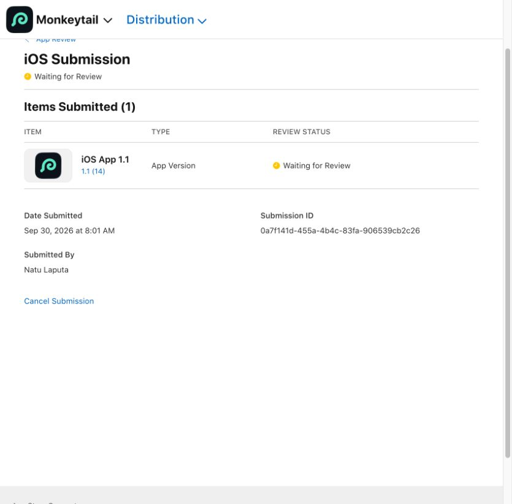
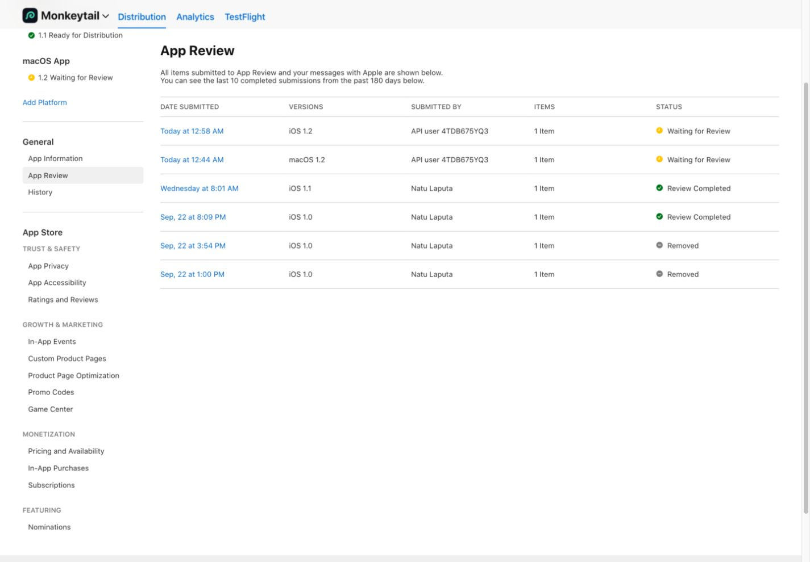

# App Store release

Monkeytail is free with no in-app purchases. The publisher is Kitta Co (Apple organization: Kitta Ltd). The app record is [6814706725](https://appstoreconnect.apple.com/apps/6814706725/distribution).

Version **1.0 (13)** is live on the App Store. It was resubmitted on September 22, 2026 and entered **Waiting for Review**. [Submission 72bc0389-c4f2-4811-8370-aac6a1d4eea7](https://appstoreconnect.apple.com/apps/6814706725/distribution/reviewsubmissions/details/72bc0389-c4f2-4811-8370-aac6a1d4eea7). It replaces the withdrawn build 10 submission and includes atomic response/preview publication, MIME-aware image/audio/video previews, and Hex/Binary viewers. Xcode Cloud archived and distributed commit `ecbd69a`; GitHub Actions passed. The release is configured to become available automatically after approval. App Review uses the same Kitta Co contact as DNSimple.

`metadata.json` is the English listing copy. It describes the supported interchange formats and script subset without claiming complete compatibility with other clients. Contact details stay in App Store Connect rather than this repository.

Screenshots are unedited captures from the actual native app using a loopback API fixture with sample content. The iPhone 18 Pro Max images are 1320 × 2868 for the 6.9-inch slot; iPad Pro 13-inch images are 2064 × 2752. The automated send, JSON inspection, cURL import, header editing, sharing, and rotation flow passed on both devices.

No analytics or tracking SDKs are included. App Privacy: Data Not Collected. Privacy URL: https://docs.kitta.co/monkeytail/privacy/.

Version **1.1 (14)** was submitted on September 30, 2026 at 08:01 GMT+8 and is now **Ready for Distribution**. [Submission 0a7f141d-455a-4b4c-83fa-906539cb2c26](https://appstoreconnect.apple.com/apps/6814706725/distribution/reviewsubmissions/details/0a7f141d-455a-4b4c-83fa-906539cb2c26). It adds optional iCloud Drive workspace sync, multipart/file uploads, transport diagnostics, and response snapshots/comparison/JSONPath. Xcode Cloud [build 14](https://appstoreconnect.apple.com/teams/cbaca10a-f696-4d2b-959e-0d3fa1b23452/xcode-cloud/products/503e6b3e-e4f0-497c-84de-827b8c8b88bd/builds/6c67c58d-d4e4-4508-a160-21e74978dd32/summary) archived and distributed commit `393e127` to internal TestFlight. [GitHub Actions passed](https://github.com/iebb/Monkeytail/actions/runs/36647768958).

Validation passed: 34 core tests, 22 Release hosted integration tests, and the two new Release UI flows on iPhone iOS 27; the full Debug suite also passed. Live transfer between two signed-in iCloud devices remains unverified; merge and offline behavior are covered by tests. Credentials use the local Keychain, and sync excludes secret values and file bytes by default. `ITSAppUsesNonExemptEncryption` remains false. The signed archive has one deprecation warning for the legacy iCloud identity-token decoder.

The release is configured to become available automatically after approval, with no app sign-in required. Kitta Co privacy/support pages were updated in commit `f4d4037` of `kitta-co/privacy-policy`.

## Version 1.2 — iPhone, iPad, and native Mac

Both platforms were submitted on October 3, 2026 (Singapore time), with automatic release after approval:

| Platform | Version/build | Verified state | Submission |
| --- | --- | --- | --- |
| iOS | 1.2 (18) | Waiting for Review | [f63062a6-f0cb-45b8-8517-65dc67834c90](https://appstoreconnect.apple.com/apps/6814706725/distribution/reviewsubmissions/details/f63062a6-f0cb-45b8-8517-65dc67834c90) |
| macOS | 1.2 (17) | Waiting for Review | [2cbc5088-bc7b-48b1-8c7f-ebe0ce5ea0fe](https://appstoreconnect.apple.com/apps/6814706725/distribution/reviewsubmissions/details/2cbc5088-bc7b-48b1-8c7f-ebe0ce5ea0fe) |

The release adds all ten API tool improvements documented in `APITools.md`, including folders/inheritance, OAuth/API keys/AWS signing, cookies, visual tests, OpenAPI, GraphQL, live protocols, client identities/TLS details, client code export, and offline mocks. The native Mac shares the iOS workspace format and iCloud Documents container. No Monkeytail accounts were added. Live transfer between physical iPhone and Mac remains unverified.

Both Xcode Cloud archives succeeded at `6aafc12`. GitHub Actions passed 48 core and six Mac integration tests. The Cloud iPhone 18 Pro / iOS 27 run passed 28 hosted integration and ten UI tests, including OpenAPI/visual tests/offline mocks and response/MIME regressions. One certificate-import test emitted Apple's main-thread performance warning; the test passed.

Mac screenshots are actual native 2560 × 1600 captures. English metadata and Kitta product, privacy, and support pages were updated. Both builds declare no non-exempt encryption; App Privacy remains Data Not Collected.

